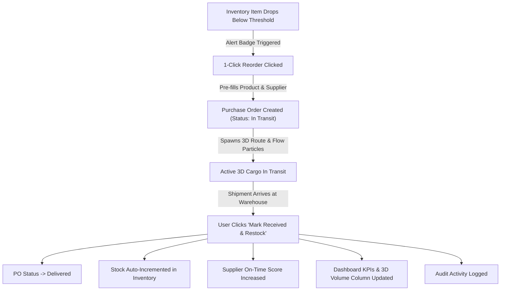

# CorpLogistics SRM Pro &mdash; Enterprise Supplier & Supply Chain Management System

An interactive, single-page enterprise web application designed for end-to-end supplier relationship management (SRM), real-time inventory monitoring, purchase order freight tracking, and 3D global logistics network visualization.

---

## 📌 Table of Contents
- [Executive Overview](#-executive-overview)
- [Key Features](#-key-features)
  - [1. Real-Time 3D Logistics Topology Visualizer](#1-real-time-3d-logistics-topology-visualizer)
  - [2. Supplier Directory & Vendor Management](#2-supplier-directory--vendor-management)
  - [3. Inventory Assets & Stock Monitoring](#3-inventory-assets--stock-monitoring)
  - [4. Purchase Orders & Automated Restocking](#4-purchase-orders--automated-restocking)
  - [5. Vendor Scorecards & Compliance Analytics](#5-vendor-scorecards--compliance-analytics)
  - [6. Real-Time Audit Feed & Reporting](#6-real-time-audit-feed--reporting)
- [Technology Stack](#-technology-stack)
- [System Architecture & Data Connectivity](#-system-architecture--data-connectivity)
  - [The Closed-Loop Procurement Workflow](#the-closed-loop-procurement-workflow)
  - [State Persistence Model](#state-persistence-model)
- [File & Project Structure](#-file--project-structure)
- [Getting Started & Usage](#-getting-started--usage)
- [Browser Compatibility](#-browser-compatibility)

---

## 🚀 Executive Overview

**CorpLogistics SRM Pro** centralizes the entire procurement and vendor lifecycle into a responsive, client-side enterprise web portal. Built with modern web standards and Three.js WebGL graphics, the system eliminates communication silos between inventory tracking and vendor procurement through a **closed-loop automated restocking workflow**.

Every supplier, SKU, and shipment in the system is directly interconnected with the live 3D visualization and dashboard metrics.

---

## 🌟 Key Features

### 1. Real-Time 3D Logistics Topology Visualizer
- **WebGL Interactive Globe & Grid**: Renders a dynamic logistics network featuring central command hubs (*Global HQ - Frankfurt*) and globally distributed vendor nodes.
- **Dynamic 3D Volume Columns**: Vertical 3D cylinder bars on each vendor node dynamically scale according to the total inventory volume supplied by that vendor.
- **Animated Freight Flow Particles**: Curved 3D Quadratic B&eacute;zier routes connect suppliers to hubs. When an order is **In Transit**, high-velocity golden freight particles travel along the route in real time.
- **Raycasting & Node Inspection**: Hovering over any 3D node renders an informative floating tooltip. Clicking any node focuses the **Network Inspector panel** with the vendor's profile, contact info, supplied SKUs, and quick-order actions.
- **Camera Controls**: OrbitControls enabled for smooth rotation, zooming, panning, camera reset, and auto-rotation toggling.

### 2. Supplier Directory & Vendor Management
- **Full CRUD Operations**: Register new suppliers, update vendor contact details, modify lead times, and delete inactive vendors (with active inventory/order dependency checks).
- **Classification & Tiers**: Manage vendors by status (*Active*, *Under Review*, *Inactive*) and strategic tier (*Tier 1 Preferred*, *Tier 2 Approved*, *Tier 3 Probationary*).
- **Vendor Dossiers**: Detailed modal view displaying compliance certifications (*ISO 9001*, *RoHS*, *CE*, *C-TPAT*), on-time delivery percentages, quality score breakdown, and all supplied products.
- **Live Search & Multi-Filter**: Instantly filter vendors by search term, status, or tier.
- **CSV Data Export**: One-click download of the active vendor directory in standard CSV format.

### 3. Inventory Assets & Stock Monitoring
- **SKU Catalog Management**: Add, update, and manage product SKUs with supplier assignments, storage locations, unit costs, and total valuation calculations.
- **Automated Threshold Warnings**: Real-time stock status computation:
  - 🟢 **Optimal**: Healthy buffer stock.
  - 🟡 **Reorder Level**: Stock within 150% of the reorder threshold.
  - 🔴 **Critical Low**: Stock below threshold with visual alert badges across the UI.
- **Stock Adjuster**: Adjust warehouse stock (+/-) with built-in audit reasons (*Cycle Count*, *Production Consumption*, *Damage Write-Off*, *Physical Audit Correction*).
- **1-Click Reorder**: Direct button on low-stock items to generate an expedited Purchase Order with pre-filled quantities and supplier data.
- **CSV Export**: Export all inventory assets with valuation metrics.

### 4. Purchase Orders & Automated Restocking
- **Procurement Order Generator**: Create POs with auto-generated PO numbers, item selections, expected delivery dates, shipping route, carrier info, and auto-calculated invoices.
- **Shipment Status Tracking**: Track orders through lifecycle stages (*Draft*, *Pending*, *In Transit*, *Delivered*, *Cancelled*).
- **Automated Receiving & Stock Deposit**: Clicking **"Mark Received & Restock"** automatically:
  - Updates PO status to `Delivered`.
  - Automatically deposits the received unit quantities directly into inventory stock.
  - Updates the supplier's on-time rating and delivery score.
  - Recalculates dashboard KPIs and 3D logistics node bar heights.
  - Logs the event in the audit activity feed.
- **Commercial Invoice Viewer**: Clean modal displaying the itemized purchase order and logistics carrier metadata.

### 5. Vendor Scorecards & Compliance Analytics
- **Quantitative Performance Matrix**: Compares suppliers across On-Time Delivery %, Quality Compliance %, and Total Active Procurement Value.
- **Risk Assessment**: Identify low-performing or delayed suppliers before supply chain disruption occurs.

### 6. Real-Time Audit Feed & Reporting
- Real-time event logging capturing vendor registrations, stock adjustments, purchase order dispatches, and shipment receipts.
- Fast reset button (**"Reset to Demo Data"**) to restore baseline demo data at any time.

---

## 🛠 Technology Stack

| Layer | Technology | Details |
| :--- | :--- | :--- |
| **Markup & Structure** | **HTML5** | Semantic, accessible layout with modular page views |
| **Styling & Design** | **Tailwind CSS (v3 CDN)** | Utility-first responsive design, modern corporate color palette (`#0f172a`, `#2563eb`, `#10b981`, `#f59e0b`) |
| **Typography** | **Google Fonts (Inter)** | Modern clean sans-serif typography (weights 300 to 800) |
| **3D Graphics & WebGL** | **Three.js (r128)** | Scene graph, directional lighting, PCF soft shadows, bezier curve routes, geometry instancing |
| **Camera Controls** | **Three.js OrbitControls** | Interactive orbital manipulation with damping, polar angle clamps, and distance bounds |
| **Logic & State** | **Vanilla JavaScript (ES6+)** | Object-oriented modular state architecture, custom reactive rendering without external framework overhead |
| **Data Persistence** | **Browser LocalStorage API** | Zero-latency client-side persistence under storage key `corplogistics_srm_v2` |
| **Export Engine** | **HTML5 Blob & URL API** | Dynamic RFC-4180 compliant CSV generation and client-side download |

---

## 🔄 System Architecture & Data Connectivity

### The Closed-Loop Procurement Workflow



### State Persistence Model

All application data is structured in a centralized JavaScript state object:

```javascript
{
  suppliers: [
    { id, name, category, location, coords: {x, z}, status, tier, rating, onTimeRate, qualityScore, contact, phone, leadTimeDays, certifications, notes }
  ],
  inventory: [
    { id, name, category, supplierId, stock, threshold, unitCost, unit, location }
  ],
  orders: [
    { id, supplierId, orderDate, expectedDelivery, status, carrier, trackingNo, items: [{ productId, qty, unitPrice, total }], totalAmount, notes }
  ],
  activityLogs: [
    { time, text }
  ]
}
```

---

## 📁 File & Project Structure

```text
d:/supplier/
├── supplier_management_system_working.html   # Main self-contained web application
└── README.md                                 # Technical documentation and system reference
```

---

## 💻 Getting Started & Usage

### Direct Browser Execution (No Installation Required)
Because the entire system is self-contained with CDN dependencies, no build steps, node modules, or local servers are strictly required:

1. Double-click [supplier_management_system_working.html](file:///d:/supplier/supplier_management_system_working.html) to open in your default browser (Google Chrome, Microsoft Edge, Firefox, or Safari).
2. Click **"Launch Interactive Dashboard"** or **"Sign In to Portal"** on the landing page.
3. Explore the views:
   - **Dashboard**: Inspect the 3D topology map and view real-time KPIs.
   - **Suppliers Directory**: Manage vendors and view dossiers.
   - **Inventory Assets**: Check stock levels and trigger reorders.
   - **Orders & Shipments**: Track live shipments and click *"Mark Received & Restock"*.
   - **Vendor Scorecards**: View performance metrics.

### Running with a Local Development Server (Optional)
If running inside a web server environment:

```bash
# Using Python
python -m http.server 8000

# Using Node / npx
npx serve .
```
Then navigate to `http://localhost:8000/supplier_management_system_working.html`.

---

## 🌐 Browser Compatibility

- **Google Chrome**: 80+ (Full WebGL 2.0 & hardware acceleration recommended)
- **Microsoft Edge**: 80+
- **Mozilla Firefox**: 75+
- **Apple Safari**: 13.1+ (iOS / macOS)

---

&copy; 2026 CorpLogistics Inc. Enterprise SRM Pro. All rights reserved.
